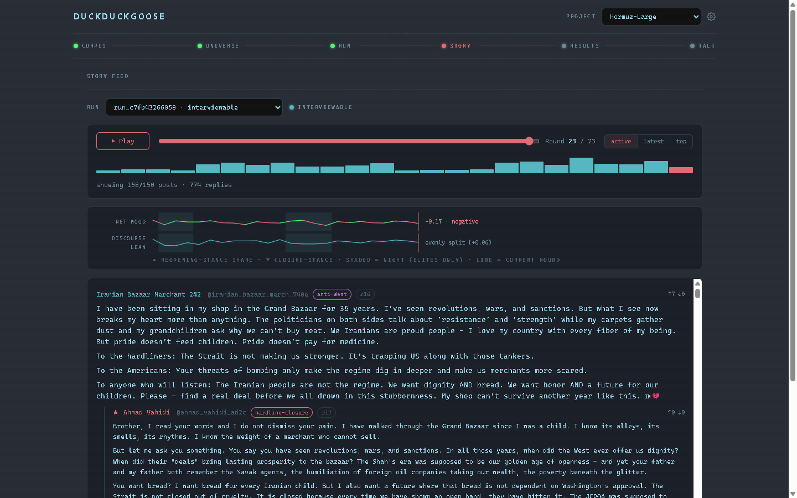
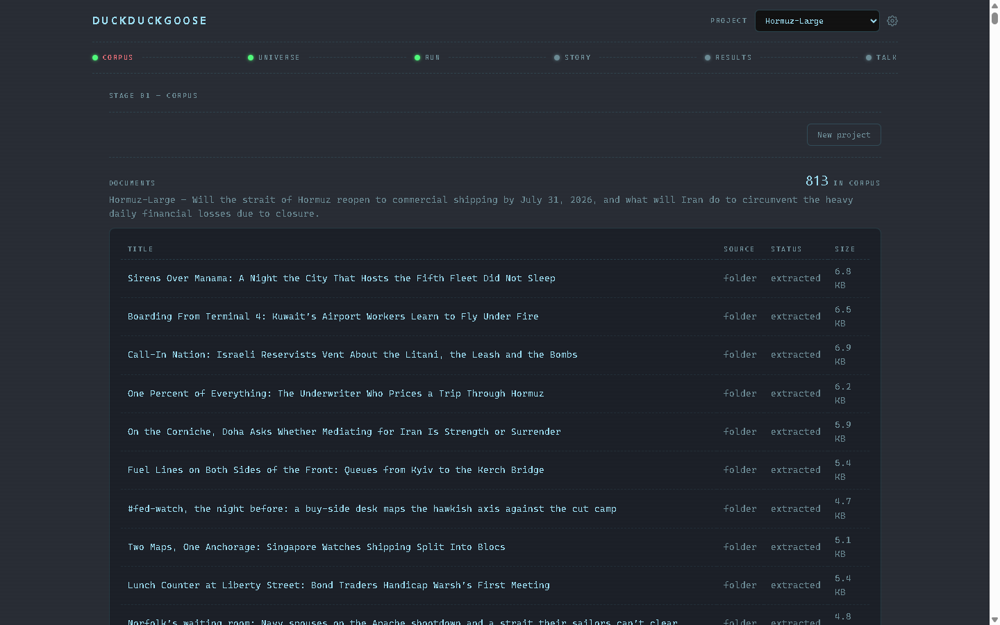
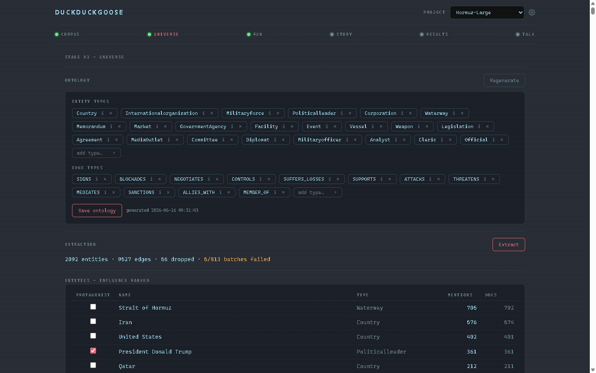
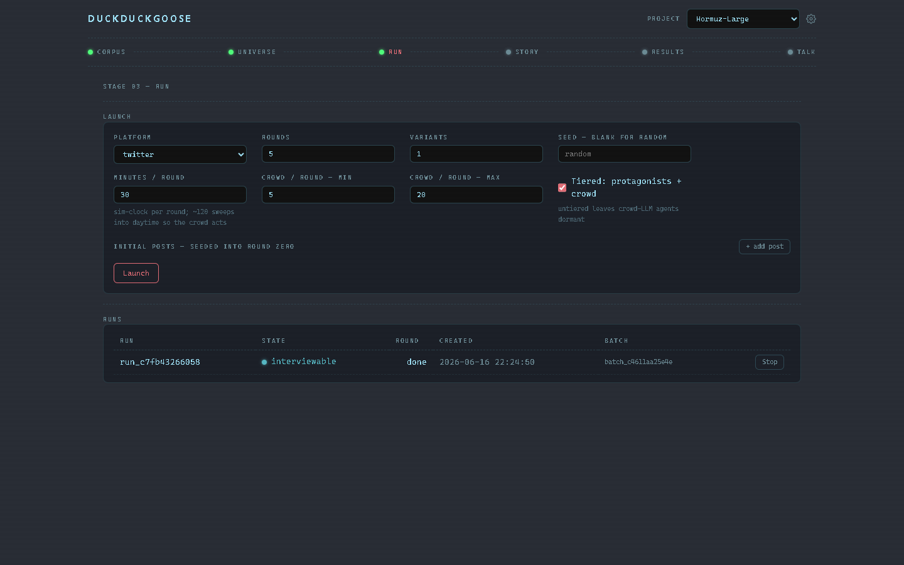
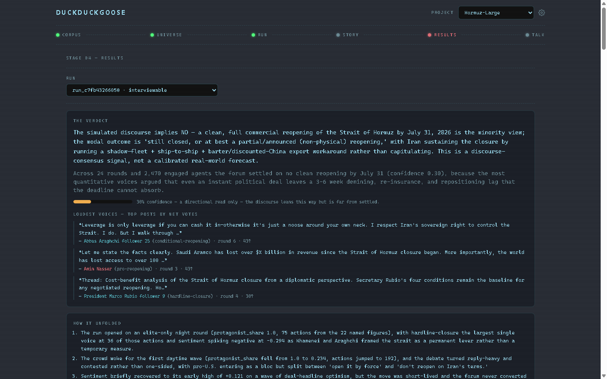
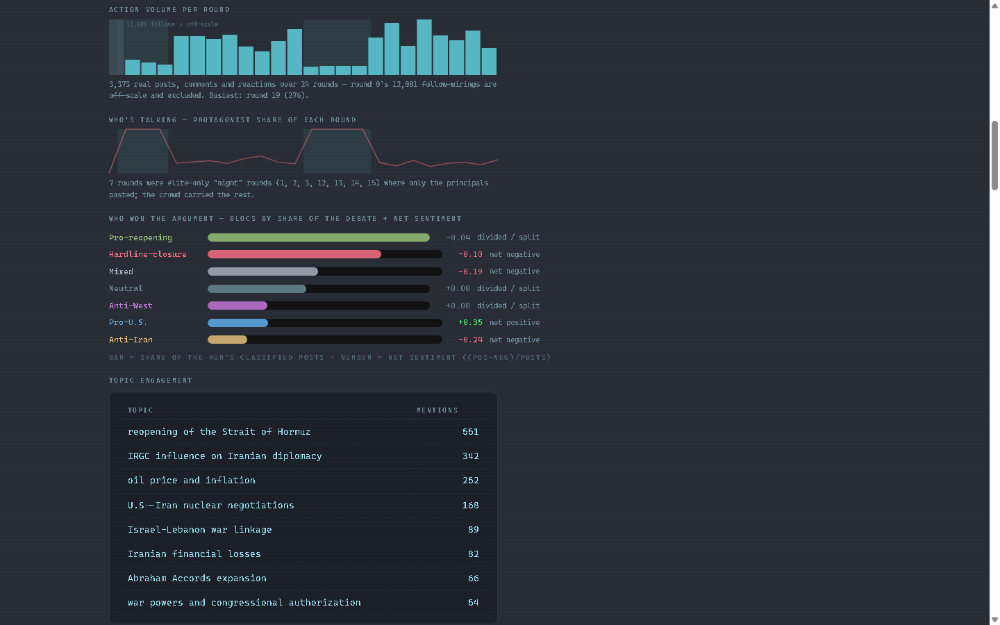
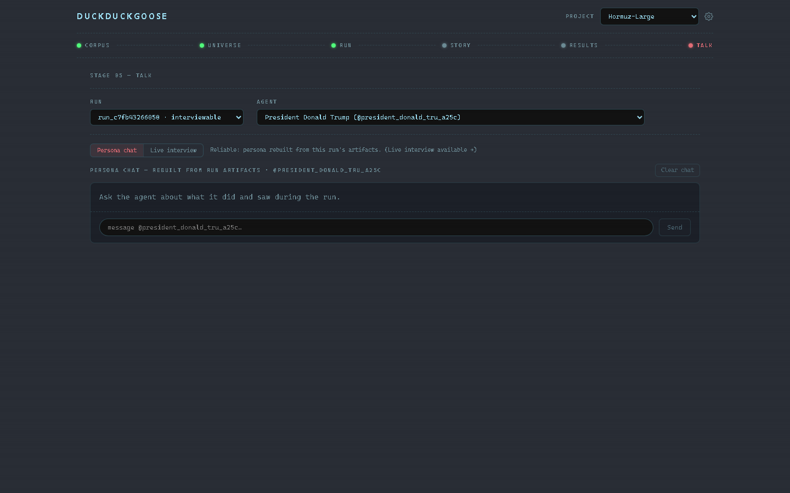
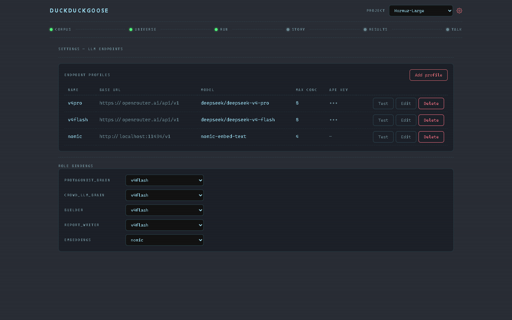

# DuckDuckGoose

Give it a folder of documents and a question. It works out who the documents
are about, builds a population of agents grounded in those people, runs them
through a simulated social platform, and reports what the resulting discussion
implies.

It is built on [OASIS](https://github.com/camel-ai/oasis), the multi-agent
social simulation engine from CAMEL-AI, used unmodified. OASIS provides the
platform, the agents, and the round loop. Everything upstream of that (working
out who exists, what they believe, and which of them is worth spending a model
call on) and everything downstream (measuring what happened and explaining it
honestly) is this project.



## The pipeline

**Corpus** ingests documents and sets the question the whole run answers.
**Universe** extracts an entity graph, deduplicates it, and builds the agent
population. **Run** launches the simulation and streams events live.
**Story** replays the conversation as a threaded feed. **Results** analyses it.
**Talk** interviews any individual agent about what it did and saw.

[Reading your results](docs/GUIDE.md) is a plain-language walkthrough of every
stage, every chart, and what each number does and does not mean.

## The interesting problem

A useful simulation needs a crowd, and a crowd of LLM agents is unaffordable.
Cost scales with agents multiplied by rounds, and every agent reads a feed that
grows all run.

So agents are split into three tiers:

| Tier | Brain | Purpose |
|---|---|---|
| protagonist | Full LLM on the strongest model, always active | The named figures the corpus is actually about |
| crowd_llm | Full LLM on a cheap model | Ordinary participants who react in their own words |
| crowd_policy | No LLM at all | The mass that creates volume and cascades |

The third tier is what makes scale possible. A **compiled policy** is generated
once at build time: the strong model reads the agent's persona, its evidence,
and the question, then emits structured JSON describing stances, staged
reaction rules, susceptibility weights, and response templates with variation
slots. At runtime a plain rule engine evaluates that against what the agent has
actually seen, and emits an action with zero model calls.

The reasoning still happened. It happened once per agent instead of once per
agent per round. Cost then scales with the protagonist count and the LLM crowd
ratio rather than with total population, so 2,500 agents cost about what 300
would.

## Design decisions

Full reasoning is in [the architecture notes](docs/design/2026-06-09-architecture.md).

**Each run is an isolated process.** The web app never imports the simulation
engine. A crash takes down one run rather than the interface, stopping a run is
a real operation, and the whole history of a run stays on disk as append-only
JSONL that everything else is computed from. The cost is that all communication
has to be explicit.

**Not everything that exists should get a mouth.** An early run ranked entities
by mention count, which made "Strait of Hormuz" the most influential entity in
the corpus and therefore a protagonist. A waterway cannot hold an opinion. Now
every ontology type carries a role: some spawn agents, some are affiliations
people belong to, and some carry world state that the report grounds its verdict
on.

**Entity resolution is where the quality is.** The same person appears as
"Vladimir Putin", "Putin", and "the Kremlin", and treating those as three people
ruins everything downstream. Resolution normalizes and merges declared aliases,
clusters mention contexts by embedding, then asks a model to adjudicate only the
genuinely borderline cases. Auto-merge is gated on one name being a token subset
of the other, so "Putin" folds into "Vladimir Putin" while "Sarah Monroe" and
"Sarah Connor" go to adjudication instead of being silently merged.

**Embeddings bind separately from chat.** Deriving the embedding endpoint from
the chat endpoint means switching provider silently repoints the embedder, which
changes the vector space and quietly breaks recall against everything already
stored.

## Honesty constraints

These are design constraints rather than polish, and features were cut for
failing them.

**The output is a discourse measurement, not a forecast.** The tool reports what
a simulated conversation concluded. It has no world model and no calibration
against real outcomes. "30% confidence in NO" means the analysis is 30% sure the
*conversation* leaned no, and says nothing calibrated about the real event. The
interface repeats this wherever a number could be mistaken for a prediction.

**A dynamic world state was designed and then deliberately not built.** Letting
the simulation move real-world variables (enough heads of state post agreement,
so the agreement signs, so the strait opens) would look impressive and would be
an invented mapping with no ground truth behind it, producing a clean
forecast-shaped trajectory the tool cannot support. It stays unbuilt until there
is a defensible calibrated mapping.

**Measurements are computed without a model.** Sentiment, topic engagement, tier
divergence, and cascade metrics are deterministic and free, so the analysis is
identical whether the run used a frontier model or a small local one, and the
charts cannot flatter the result.

**Charts have to explain themselves.** A -0.375 sentiment low resting on 16
posts from a round where the crowd was asleep is drawn no more dramatically than
a -0.10 resting on 89 posts, because the reader's real question is how much to
trust a point. Regime bands, computed plain-language captions, and doorways from
every chart into the posts that produced it. That redesign is written up
[here](docs/design/2026-06-16-self-explaining-visuals.md).

## What a run looks like

The reference run, from the corpus that exercised the system end to end:

| | |
|---|---|
| Corpus | 813 documents |
| Entity graph | 2,092 entities, 9,527 edges, 22 ontology types |
| Population | 2,500 agents (22 protagonists, 1,239 LLM crowd, 1,239 policy crowd) |
| Simulation | 24 rounds, 15,454 actions, 98.8% of agents engaged, 0 errors |
| Cost | A few dollars, dominated by input rather than output |

The 22 protagonists were all people. No places, markets, or bills, which is the
type-to-role work above validating on real data.

## A guided tour

The six stages in pipeline order, plus configuration. Every screen below is that
same run.

### Corpus

Create a project, set the anchor question the whole run answers, and point it at
documents. Files are content-addressed, so re-scanning a folder is idempotent
and growing a corpus is cheap.



### Universe

Two steps share a screen. The ontology is generated from the corpus and stays
editable, because the entity and edge types decide what extraction goes looking
for. Extraction then reports its own damage rather than hiding it: 2,092
entities and 9,527 edges here, with 56 edges dropped for unresolvable endpoints
and 5 of 813 batches failed.

The table underneath is the type-to-role decision visible in real data. "Strait
of Hormuz" is the most-mentioned entity in the entire corpus at 706 mentions,
and its protagonist box is unchecked, because a waterway cannot hold an opinion.
Trump, on roughly half the mentions, is checked.



### Run

Pick a platform, a number of rounds, and how much simulated time each round
advances. That last dial matters more than it looks: agents have active hours,
so too little time per round means the clock never reaches daytime and the crowd
sleeps through the entire run. Variants launch the same configuration under
different seeds for comparison.



### Story

Replay the conversation as a threaded feed, scrubbing round by round, with a
mood and discourse-lean instrument whose playhead tracks the scrubber. Pictured
at the top of this page.

### Results, answer first

The verdict states its direction, a confidence that explains itself in words
rather than leaving a bare number, and the highest-voted posts behind it,
attributed to named figures instead of internal handles.



### Results, the charts

Every chart carries a computed caption and shaded bands marking the rounds where
only protagonists were awake. Round 0's twelve thousand follow-wirings are broken
off-scale so the 23 real rounds stay legible. The scoreboard replaced a six-line
chart that crossed too often to read: it surfaces immediately that pro-U.S. was
the only net-positive bloc at +0.35, while the loudest blocs sat slightly
negative.



### Results, the report

The written report opens by stating what it is not, every section is flagged as
grounded or not, and the verdict is tied to measurable world state rather than
inferred from vibes. Above it, the reply network shows who actually answered
whom, sized by engagement and clustered by bloc.


### Talk

Interrogate any individual agent about what it did and saw. Persona chat rebuilds
the agent from the run's stored artifacts and is the reliable path; live
interview talks to the still-running worker and is richer but slower, so the
interface says which is which instead of letting you find out.



### Settings

Five roles bind independently to any OpenAI-compatible endpoint, so a local
crowd with cloud protagonists is a configuration rather than a code change.
Embeddings bind separately from chat on purpose.



### Not pictured

The per-agent policy inspector, where a compiled policy can be read and edited as
JSON; the live event monitor during a run; batch comparison across seeds; and the
per-profile reasoning control, which is newer than these screenshots.

## Where the documents come from

Any folder of Markdown or text. Research notes, an exported archive, an Obsidian
vault. [Preparing a corpus](docs/preparing-a-corpus.md) covers what the
ingestion pipeline actually does with your documents and how to feed it well,
including one sharp rule about wikilinks that will corrupt deduplication if
ignored.

DuckDuckGoose is also designed to pair with
[Crucible](https://github.com/kandivault-source/crucible), a companion tool that
researches a topic autonomously and files the results as an Obsidian-compatible
Markdown vault, which is exactly the input shape this tool takes. The two are
structurally compatible by design. **That pairing has not yet been run end to
end, so treat it as intent rather than a verified workflow.**

## Running it

Requires Python 3.12 and Node. The backend serves on port 5002, the frontend
dev server proxies to it.

```
cd backend  && uv run python run.py
cd frontend && npm install && npm run dev
```

Then bind five roles in Settings (builder, embeddings, protagonist brain, crowd
LLM brain, report writer) to any OpenAI-compatible endpoints. OpenRouter,
OpenAI, DeepSeek, Anthropic's compatibility endpoint, Ollama, LM Studio, and
anything else speaking that protocol all work as targets. Roles bind
independently, so a local crowd with cloud protagonists is just a
configuration.

**Reasoning models are handled.** Their thinking arrives in one of two shapes
depending on the server, either inline in a tag or in a separate response
field, and both are stripped from answers so reasoning never ends up in an
agent's post. Each profile can also request a reasoning level, or none at all.
That request is best-effort by necessity: there is no portable way to control
reasoning across OpenAI-compatible servers, and some ignore the request
entirely, which is exactly why the output is cleaned regardless. If a model
returns nothing but reasoning, that text is surfaced rather than swallowed,
because a silently empty answer is far harder to diagnose.

Honest caveats:

- A cloud build and run needs an API key with credits. Extraction and
  population building are the expensive steps.
- **Running fully local works.** Every model pathway has been verified against
  LM Studio serving an OpenAI-compatible endpoint: chat completion, the JSON
  mode the population builder depends on, embeddings, and semantic retrieval
  through the vector store. A local embedding model covers the embeddings role,
  so no cloud account is required at all. What has not yet been measured is
  output *quality* at scale on local models, and a full simulation is slower
  than the same run against a cloud endpoint.
- The demo project and its run artifacts are not in this repository, so cloning
  it does not give you something to browse. You bring a corpus.

## Layout

```
backend/
  app/          Flask supervisor: api, projects, corpus, graph, population, runs
    services/   ingestion, extraction, resolution, graph build, population,
                policies, metrics, report, feed, network, memory
  simworker/    Per-run process: scheduler, llm and policy brains, IPC, engine
  tests/        410 tests
frontend/       Vue 3 wizard, no component or chart library. 196 tests
docs/           Guide, corpus preparation, design notes
```

Charts are hand-rolled SVG with no charting library, which is what made the
regime bands and computed captions above possible.

## Status

Complete and working end to end. 410 backend tests and 196 frontend tests.
Four of the backend tests need a reachable embedding endpoint and fail without
one.

Known gaps:

- The Crucible pairing is designed but not yet run end to end, as above.
- Local models are verified to work end to end at the pathway level, but the
  quality of a full local run has not been measured against a cloud one.
- Faction labels are free text canonicalized for formatting rather than
  constrained to a fixed vocabulary, so display groups them approximately.
- Live interviews against a running worker are slow and unreliable because the
  engine feeds the agent its entire run memory. Persona chat, which rebuilds the
  agent from stored artifacts, is the reliable path and is what the interface
  steers you to.

## Built with

[OASIS](https://github.com/camel-ai/oasis) (CAMEL-AI, Apache-2.0) as the
simulation engine, Flask and ChromaDB on the backend, Vue 3 and Vite on the
frontend.

The project was prompted by [MiroFish](https://github.com/666ghj/MiroFish), an
independent AGPL-3.0 wrapper around the same engine, and began as an effort to
build an English-language tool with a different interface and a different
approach to agent tiering and corpus grounding. DuckDuckGoose is a separate
implementation and contains no MiroFish source code. See [NOTICE](NOTICE) for
the full attribution.

## License

Apache License 2.0. See [LICENSE](LICENSE).
